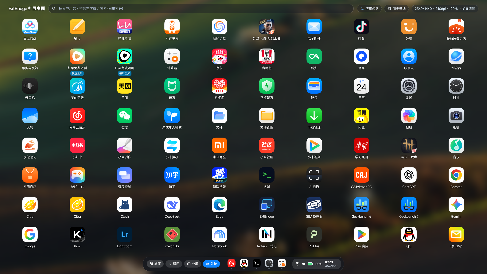
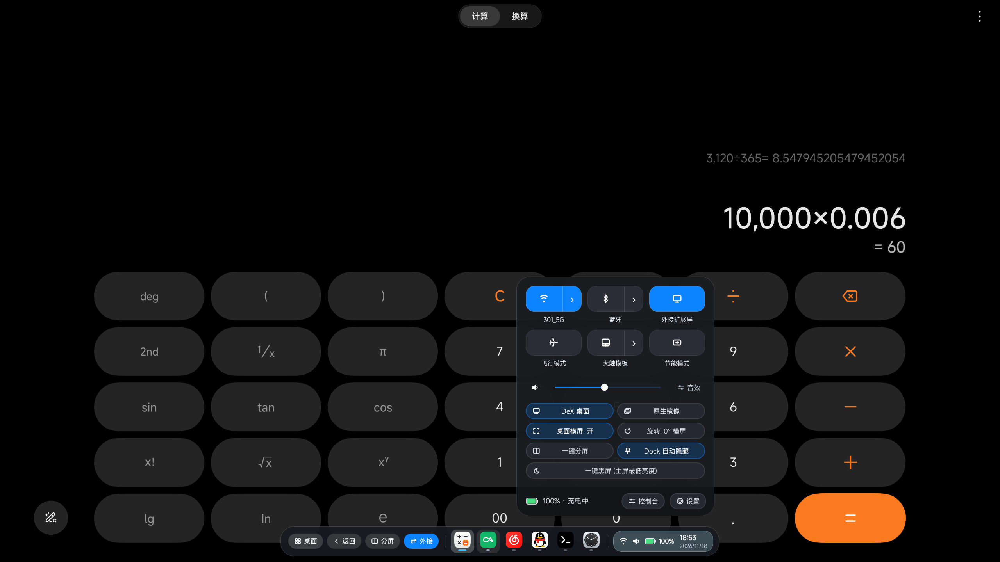
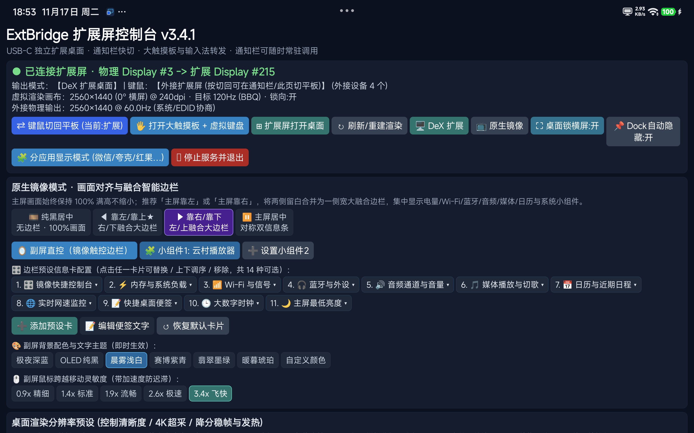
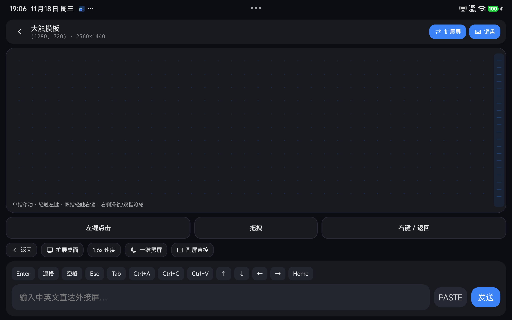

# ExtBridge — Android 免 Root Type-C 类 DeX 独立扩展桌面系统

> **无需 Root · 只需单个 APK（内置无线调试自激活）· 让支持 DP Alt Mode 的 Android 手机 / 平板插上 Type-C 显示器即刻拥有独立的 PC 级扩展桌面。**

许多 Android 设备（如小米 / REDMI 手机与平板在 HyperOS 下）默认仅对外接显示器提供**屏幕镜像（Mirroring）**，主屏和副屏画面完全一致、比例受限且无法独立操作。**ExtBridge** 通过 Shell 权限守护进程接管外接物理显示屏，在其上呈现一个独立分辨率/DPI/刷新率的 VirtualDisplay，并搭配完整的桌面启动器、底部 Dock 任务栏、快捷控制面板、硬件光标映射、虚拟触摸板与分应用显示模式管理，实现接近 Samsung DeX 的双屏独立办公与娱乐体验。

---

## ✨ 核心特性

- **🖥️ 真·双屏独立扩展桌面（支持一键切换原生镜像）**
  - 自动探测物理外接显示器 (`Display.TYPE_EXTERNAL`)，在黑屏占位的物理副屏之上通过 `SurfaceControl` 投射独立的 `VirtualDisplay`（首次接入自动按外接显示器原生分辨率/刷新率适配桌面与比例 DPI）。
  - **独立「桌面渲染分辨率」调节（100% 生效，区分于硬件物理信号）**：支持在控制台预设 `3840×2160 (4K 超采)`、`2560×1600`、`2560×1440`、`1920×1200`、`1920×1080`、`1600×900`、`1280×720 (省流)` 及自定义宽高，精准控制桌面真实的 GPU 渲染负载、超采样锐度与宽高比；同时在部分支持该 API 的机型上同步尝试下发 EDID 物理模式切换。
  - **四向自定义输出旋转（`0° / 90° / 180° / 270°`）与竖屏输出**：将外接便携屏/显示器物理竖立时，可在控制台或快捷面板一键旋转 `90° / 270°` 满屏点对点竖屏显示（也可在横屏上点「⇅ 对调宽高」居中显示竖屏桌面），指针/触摸板与 Dock 自适应同步。
  - 随时在 **ExtBridge DeX 独立桌面** 与 **原生镜像模式** 之间一键无缝切换，适配不同使用场景。
- **🧩 分应用显示模式（告别部分应用适配崩坏）**
  - 每个应用可独立配置 4 种显示策略（配置持久化于 `/data/local/tmp/extbridge_apps.conf`，互不干扰，不篡改全局 `Settings.Global` 开关）：
    1. **跟随系统默认**（默认）：零兼容注入，确保微信、夸克、拼多多等应用保持正常比例与布局。
    2. **强制横屏全屏**：针对短剧/竖屏视频等强制锁定竖屏的 App（如红果短剧），通过 `am compat` 精准解锁横屏全屏沉浸观看。
    3. **竖屏居中兼容**：面向固定竖屏比例的电商/工具 App，防止拉伸错位。
    4. **自由小窗模式**：以桌面 Freeform 小窗尺寸启动并支持自由调节。
  - 在控制台首页可按名称/包名搜索配置或「一键全部重置」，也可在扩展桌面**长按 / 鼠标右键应用图标**即时调整。
- **🚀 高颜桌面启动器 + 悬浮 Dock 任务栏 + 快捷中心**
  - **独立扩展桌面 (`LauncherActivity`)**：实时同步设备原机壁纸与 GPU 高斯毛玻璃模糊背景，支持中文/英文包名/**拼音首字母**模糊检索（回车直达启动），图标按自定义模式显示彩色角标。
  - **自适应 Dock 与快捷面板 (`BridgeService`)**：DPI 自适应缩放的悬浮底部栏（桌面键、返回键、平板/扩展屏键鼠热切、正在运行任务快速切换），右下角呼出快捷开关面板（音量滑动条、Wi-Fi/蓝牙/设置跳转、DeX 策略与原生镜像快切）。
- **📱 手机端增强触摸板与输入法转发 (`TouchpadActivity`)**
  - 没有实体键鼠时，手机/平板变身**大面积全高触控板**：支持单指移动、轻触左键、双指右键、右侧边缘专属滚轮滑动区、拖拽锁定开关、灵敏度调节（`0.6x ~ 2.4x`），以及点击弹出软键盘并**直接将输入字符/回车/退格转发到外接屏焦点应用**。
  - 自动在平板/手机端启用原生导航手势保护，确保主屏侧滑返回与上滑回桌面不受影响。
- **⚡ 单 APK 三模自激活（Root 一键 / 本机无线调试 / 电脑 ADB）**
  - 已 Root 设备（Magisk / KernelSU / APatch）：完全不需要开启开发者选项或 ADB 权限，App 内点一下 **「👑 一键 Root 注册并激活服务」** 即可自动完成授权与守护进程拉起（拉起后自动降权为 `uid 2000 shell` 身份运行），并支持下次打开软件自动静默重激活。
  - 未 Root 设备：安装包内直接打包了 `arm64-v8a` 原生 `adb` 二进制与 `extbridge.jar`，支持通过本机 **无线调试 + mDNS 自动发现配对** 在手机内一键激活（自动过滤 `tun*`/`utun*` 等 VPN 虚拟网卡干扰），也支持在电脑端执行一句 `adb shell` 启动。

---

## 📸 实机效果展示

| 独立扩展桌面启动器（壁纸毛玻璃 + 拼音检索 + EDID 自适应） | 扩展屏底部 Dock 栏与快捷控制浮窗 |
| :---: | :---: |
|  |  |

| 短剧/视频应用强制横屏全屏（2560×1440 大屏满铺 + 底部 Dock） | 手机端控制台主页与大触摸板模式 |
| :---: | :---: |
|  |   |

---

## 🏗️ 整体架构与目录结构

```text
├── bridge/                                  # Shell 权限后台守护进程（app_process 启动）
│   └── src/com/extbridge/daemon/
│       └── ExtBridge.java                   # 物理屏接管、VirtualDisplay/SurfaceControl 投射、
│                                            # Binder IPC (ContentProvider 握手)、键鼠注入、分应用兼容策略
├── helper/                                  # Android 客户端 App (com.extbridge.helper)
│   ├── AndroidManifest.xml
│   ├── jniLibs/arm64-v8a/libadb.so          # 内置 arm64 adb 二进制，供免电脑无线调试自激活使用
│   ├── res/
│   └── src/com/extbridge/helper/
│       ├── MainActivity.java                # 控制台 UI（分辨率/DPI/刷新率、分应用显示模式管理、激活引导）
│       ├── LauncherActivity.java            # 外接屏桌面启动器（壁纸同步、拼音检索、右键/长按改模式）
│       ├── TouchpadActivity.java            # 手机/平板端大触摸板与软键盘输入转发
│       ├── BridgeService.java               # 前台服务、光标悬浮层、底部 Dock、快捷控制面板
│       ├── BridgeClient.java                # Binder IPC 客户端封装
│       ├── BridgeProvider.java              # 启动阶段零延迟传递 Binder 句柄
│       ├── ControlReceiver.java             # 通知栏快捷按钮广播响应
│       ├── NavAssistService.java            # 无障碍辅助服务（高级浮层、全局手势与设置穿透必需）
│       ├── AdbBootstrap.java                # mDNS 自动发现、无线调试配对连接、守护进程拉起
│       └── AdbPairingReceiver.java          # 通知栏输入 6 位配对码快捷激活
├── docs/images/                             # 项目图文说明截图
├── .github/workflows/build.yml              # GitHub Actions 云端自动编译打包与 Release 工作流
├── build_v3.ps1                             # Windows 一键编译打包脚本（无需 Gradle，直接调 javac/d8/aapt2）
└── start_extbridge.sh                       # 手机/ADB 手动启动守护进程脚本
```

### 工作流简述

```text
  [Type-C 接入外接显示器]
            │
            ▼
  ExtBridge 守护进程 (Shell UID, app_process)
   ├─ 探测物理 Display + 查询 EDID Modes，按需切换硬件分辨率/刷新率
   ├─ 创建 VirtualDisplay + SurfaceControl 将桌面安全隔离渲染至外接屏
   ├─ 通过 ContentProvider 回传 Binder 句柄给 com.extbridge.helper
   └─ 接管外接 HID / 触摸板事件映射注入至 VirtualDisplay，并按应用包名执行兼容模式
            │
            ▼
  ExtBridge Helper App
   ├─ 主屏：控制台 (MainActivity) / 通知栏快捷控制 / 大触摸板 (TouchpadActivity)
   └─ 外接屏：独立桌面启动器 (LauncherActivity) + 自适应 Dock & 快捷面板 (BridgeService)
```

---

## 🚀 快速上手

### 1. 环境要求
- 支持 USB-C 视频输出（DP Alt Mode）的 Android 设备（**Android 11 / API 30 及以上，建议 Android 14–16**，ARM64 架构）。
- 已在小米 HyperOS 设备（**REDMI K Pad**、**REDMI K90 Pro** 等）实测可用；其他品牌机型因系统 Hidden API 差异，部分兼容性策略效果可能有所不同。
- 首次启动会引导授予 3 项必需权限：**通知权限**（快捷控制与无线调试快捷配对）、**悬浮窗权限**（显示扩展屏桌面 Dock 与光标）、**无障碍服务（`ExtBridge 平板辅助手势`）**（外接屏高级浮层、手势与设置穿透；若 Android 13+ 开关变灰提示“受限设置”，可点引导按钮进应用详情右上角 `⋮ → 允许受限设置`，或在 ADB 激活后自动解锁）。
- 若使用手机触摸板时发现有点击动画但点不动图标/Dock 栏，小米 / HyperOS / 部分品牌机型请在 **「开发者选项」** 中开启 **「USB 调试（安全设置）/ 允许模拟点击」**。

### 2. 安装与激活后台守护进程
安装编译好的 `exthelper.apk` 后，守护进程会在系统重启后失效，需要激活一次（三选一）：

#### 方式 A：已 Root 设备（无需 ADB / 开发者选项）
1. 打开 **ExtBridge**，在激活弹窗选择 **「👑 Root 激活 (免 ADB 权限)」**。
2. 点击 **「👑 一键 Root 注册并激活服务」**，在 Magisk / KernelSU / APatch 弹窗中允许授权即可秒连。
3. 开启 **「启动软件时自动 Root 激活」**（首次激活后默认自动开启）后，今后重启手机再点开 ExtBridge 即可自动静默拉起后台服务。

#### 方式 B：免 Root 免电脑，App 内本机无线调试激活
1. 打开 **设置 → 开发者选项 → 无线调试**，开启无线调试。
2. 打开 **ExtBridge**，点击弹窗中的「发送快捷配对通知」或在「使用配对码配对设备」查看 **端口与 6 位配对码**。
3. 回 App 填写配对码并点击 **「配对并激活」**（若之前已配对，可直接点 **「已配对·直接连接」**）。
> 提示：若设备开有 VPN，ExtBridge 已自动跳过 `tun*` 虚拟网卡并优先锁定物理局域网 `wlan0` IP。

#### 方式 C：免 Root + 电脑端 ADB 一键拉起
连接电脑后执行控制台弹窗中给出的一键命令即可（若同时连了多台设备，请加上 `adb -s <设备序列号>`）：
```bash
adb shell "(pm path com.extbridge.helper | head -n1 | cut -d: -f2; echo assets/extbridge.jar) | xargs unzip -p > /data/local/tmp/extbridge.jar && chmod 644 /data/local/tmp/extbridge.jar && appops set com.extbridge.helper SYSTEM_ALERT_WINDOW allow && appops set com.extbridge.helper RUN_ANY_IN_BACKGROUND allow && appops set com.extbridge.helper 10021 allow 2>/dev/null; appops set com.extbridge.helper ACCESS_RESTRICTED_SETTINGS allow 2>/dev/null; pm grant com.extbridge.helper android.permission.POST_NOTIFICATIONS 2>/dev/null; dumpsys deviceidle whitelist +com.extbridge.helper >/dev/null 2>&1; pkill -f '^app_process.*ExtBridge' 2>/dev/null; sleep 0.2; CLASSPATH=/data/local/tmp/extbridge.jar nohup app_process /data/local/tmp com.extbridge.daemon.ExtBridge >/data/local/tmp/extbridge.log 2>&1 </dev/null &"
```

### 3. 连接显示器并优化体验
1. 通过 Type-C 线或扩展坞连接显示器，外接屏会自动弹出 **ExtBridge 扩展桌面**。
2. 手机作为信号源使用时，推荐在控制台点击 **「手机推荐：一键横屏平板大屏」**（例如 `1920×1080 @ 240dpi`，可使等效 `smallestWidth` 达到 `sw800dp` 触发 App 平板横屏布局）。
3. 若发现个别应用显示错位（或无法横屏全屏）：
   - 进入控制台 **「🧩 分应用显示模式」** 或在桌面 **长按 / 右键点击图标**，按需切换「跟随系统默认 / 强制横屏全屏 / 竖屏居中兼容 / 自由小窗模式」。
   - **微信、夸克、拼多多** 等推荐保持 **「跟随系统默认」**；**红果短剧** 等默认预置为 **「强制横屏全屏」**。
4. 不再使用外接屏时，可在控制台顶部或待机通知栏点击 **「⏻ 停止服务并退出」**，一键恢复外接屏并彻底退出后台守护进程与前台通知（强行停止 App 也不会自动拉起）。

---

## 🛠️ 从源码编译

本项目不依赖 Gradle 庞大的构建环境，Windows 下只需 **JDK 17+** 与 **Android SDK (`build-tools` + `platforms/android-30+`)** 即可秒级编译打包：

```powershell
# 自动查找本地 JAVA_HOME 与 ANDROID_HOME，输出至 build\out\exthelper.apk 与 extbridge.jar
powershell -ExecutionPolicy Bypass -File .\build_v3.ps1
```

- 脚本会自动从 `helper/jniLibs/arm64-v8a/libadb.so` 与编译出的 `extbridge.jar` 打入 `exthelper.apk`。
- 若仓库根目录下不存在私有的 `exthelper.p12`（亦可通过环境变量 `$env:EXTBRIDGE_KEYSTORE` 指定），脚本会自动在 `build\debug.keystore` 生成测试签名完成 APK 签名。
- 完整版本迭代记录见 [CHANGELOG.md](CHANGELOG.md)。

---

## 📖 分辨率功能详解 & 为什么不做深入 Root 系统改动

### 1. 「桌面渲染分辨率」与「外接物理输出」有什么区别？为什么切了依然有意义？

部分用户在控制台切换分辨率后会发现：显示器本身 OSD 菜单显示的**外接物理输出**（例如 `2560×1440 @ 60Hz` 或 `1920×1080 @ 60Hz`）没有变化。这里必须区分两个完全不同的概念：

1. **外接物理输出（显示器 EDID 信号，受手机系统固件控制）**：
   - 在 **Xiaomi HyperOS** 等系统的正式版固件中，经无线调试实测：系统 `DisplayModeDirectorImpl` 会限制外接屏 `displayId` 与帧率上限，底层 `SurfaceFlinger` 收到 `setDesiredDisplayModeSpecs` 时也会直接警告 `Attempt to set desired display modes for external display` 并丢弃外接物理屏的模式切换请求，使显示器固定停留在 EDID 默认首档（通常为 `1080p@60` 或 `2K@60`）。
2. **桌面渲染分辨率（`VirtualDisplay` 实际画布，ExtBridge 在所有机型上 100% 生效）**：
   - ExtBridge 的分辨率预设与自定义输入框改的是扩展桌面 **`VirtualDisplay` 的真实渲染缓冲尺寸**，再交由硬件合成器实时等比/居中缩放铺满到外接屏上。即使物理输出被系统锁死，调节它仍然具备**非常明确的实用价值**：
     - **降分辨率减负稳帧 / 降发热**：将渲染分辨率调为 `1280×720`、`1600×900` 或 `1920×1080`，桌面内所有应用和游戏都会真实按低像素渲染（`720p` 像素量仅为 `2K` 的 `1/4`），显著降低 GPU 渲染压力与机身发热。
     - **高分辨率超采样锐化**：将渲染分辨率设为 `3840×2160 (4K 超采)` 再下采样缩放到 `1080p / 2K` 显示器上，可获得更细腻的文字抗锯齿与画面锐度。
     - **自由宽高比 / 平板大屏触发 / 四向竖屏适配**：`16:10`、`16:9`、带鱼屏宽高比以及 `90° / 270°` 竖屏满铺都依赖 `VirtualDisplay` 渲染宽高配合 `DPI`（触发 `sw ≥ 600dp` 平板横屏布局）。

> 在控制台勾选 **「▸ 高级：外接物理信号与帧率尝试」** 可查看并尝试请求物理模式/刷新率；若系统固件锁死外接物理信号（如 Xiaomi HyperOS 固定输出 60Hz 首档），v3.2.2 起控制台会明确提示“已切换虚拟桌面，当前系统固件锁定外接物理输出”，避免主界面堆叠无法生效的刷新率档位引起困惑。

### 2. 项目定位说明：为什么不提供 Root Hook（Zygisk / LSPosed）模块？

* **初衷定位**：ExtBridge 的设计初衷是做一款**免 Root、单个 APK、不改系统文件即可随插即用**的便携扩展桌面工具。
* **Root 功能的边界**：虽然理论上通过 Root + Zygisk/LSPosed Hook `SurfaceFlinger` 与系统框架可以绕开厂商对外接物理高刷/物理分辨率的限制，但这已经背离了项目“免 Root 轻量化便携”的初衷，也会引入不同 ROM、系统版本升级后变砖/黑屏/维护成本高等问题。
* **对 Root 用户的支持**：当前保留 **「👑 一键 Root 注册并激活服务」** 仅用于帮已 Root 用户省去无线调试配对步骤（守护进程在 Root 拉起后会立即降权回 `uid=2000 shell` 身份运行），**项目不会往修改系统框架/内核的 Root Hook 方向发展**。

---

## ⚠️ 注意事项与免责声明
- 本项目使用非公开 Android 系统 API（通过 shell 权限 `app_process` 进程注入 `DisplayManager` / `SurfaceControl` / `ActivityTaskManager` / `am compat`），**不会破坏系统分区**，但不同系统版本或魔改 ROM 可能存在兼容性差异。
- `am compat` 的自定义覆盖会写入系统用户策略，如需彻底清除所有历史兼容覆盖，可在 App「分应用显示模式」内点击 **「↺ 全部重置为默认」**，或在电脑执行 `adb shell am compat reset-all <packageName>`。
- 基于 [MIT License](LICENSE) 开源。
