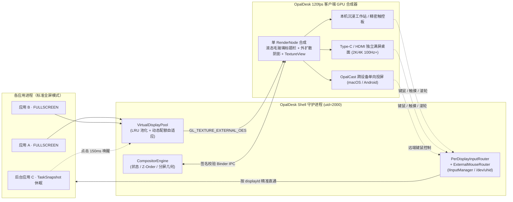

# OpalDesk (`v1.0.0` · Universal Compositor Edition)

> **全品牌安卓通用 · 免 Root 优先 · Wayland 式「一窗一独立虚拟屏」120fps 液态毛玻璃多窗合成工作站**

**OpalDesk v1.0.0** 完成了自项目启动以来最彻底的一次底层架构重写。我们完全摒弃了早期基于系统自由小窗（Freeform）与悬浮窗贴片拼接的传统路线，从零打造了一套面向 **Android 11–17** 的 **Wayland 式独立虚拟屏池 + 客户端 GPU 统一合成引擎**，并配套全新设计的 **macOS 液态毛玻璃（Liquid Frosted Glass）桌面环境**、**物理键鼠全局跨屏路由**、**多列 Pro 分屏工作流** 以及 **Android ↔ Mac / Android ↔ Android 跨设备单向互投**。

---

## 🧭 为什么我们要进行彻底的底层重构？

在早期原型（`v0.0.x`）阶段，OpalDesk 沿用了安卓桌面模式最常见的技术路径：**在共享虚拟屏或副屏上调用系统 `WINDOWING_MODE_FREEFORM (5)` / `MULTI_WINDOW (6)` / `ITaskOrganizer` 排列窗口，并用 `SYSTEM_ALERT_WINDOW` 悬浮窗覆盖在应用上方绘制标题栏与控制条**。

在小米 HyperOS、类原生 AOSP 与外接 2K 100Hz 显示器的真实高强度使用中，这条旧路线暴露出了 **5 个无法靠打补丁根治的结构性死结**：

1. **厂商私有小窗碎片化与系统“反抗”**
   不同品牌 ROM 对 Freeform 小窗的魔改差异极大：有的系统强制塞入厚重白边、弹簧回弹与非标准标题栏，有的系统在升级后直接封堵私有 API（如 `com.miui.*` / 特定 AppOps），还有的类原生 ROM 甚至缺乏完整的自由窗口实现。靠反射硬刚各家 `WindowManager` 注定陷入无止境的机型适配泥潭。
2. **“皮肉分离”的悬浮窗撕裂与高权限门槛**
   标题栏和阴影由客户端悬浮窗绘制，应用画面却由系统 `WindowManager` / `SurfaceFlinger` 异步调度。拖动或缩放窗口时，外框已经飞到了新坐标，应用内容还在原地掉帧、残影、闪烁，点击热区也随之错位；同时还强依赖敏感的「悬浮窗」与「无障碍」权限。
3. **多窗排布与层级切换的中间态闪烁**
   旧引擎每次拖放换位或分屏，都要依次触发 `resizeTask`、调整配对窗、最小化旧窗并轮询重查图层是否跟上。一个简单交互可能闪出多个中间帧，窗口 Z-Order 容易反转，甚至出现点击穿透到下层窗口又弹回的鬼畜体验。
4. **外接屏 `canHostTasks = false` 与 Android 14+ 虚拟屏配额限制**
   大量机型在连接 Type-C / DP / HDMI 显示器时仅将其标记为 `FLAG_PRESENTATION`（系统禁止直接在该屏启动普通应用任务）；同时 Android 14+ 对单 UID 可创建的 `VirtualDisplay` 数量施加了严格上限，直接开多屏极易触发系统拒绝。
5. **物理外设与跨屏交互割裂**
   连接蓝牙 / USB 鼠标后，系统默认将指针锁死在本机内屏，或者一旦切出本机 App 外接屏立刻失活；同时传统跨屏触摸注入容易在部分 ROM 上被拦截，鼠标滚轮和右键语义也难以做到接近 macOS / 桌面系统的直觉体验。

### 新旧底层架构核心对比

| 维度 | 旧架构（`v0.0.x` · 系统 Freeform + 悬浮窗拼接） | 新架构（`v1.0.0` · Wayland 式通用合成器） |
| :--- | :--- | :--- |
| **窗口运行模式** | `WINDOWING_MODE_FREEFORM (5)` / OEM 私有 API | **100% 标准 AOSP `WINDOWING_MODE_FULLSCREEN (1)`**，一窗一独立 `VirtualDisplay` |
| **品牌兼容性** | 深度绑定特定 ROM，系统更新极易失效 | **全品牌通用（Android 11–17）**：Pixel、三星、小米、OPPO、vivo、类原生表现一致 |
| **画面与标题栏合成** | `SYSTEM_ALERT_WINDOW` 贴片（皮肉分离、拖拽撕裂） | **客户端 GPU 单 `RenderNode` 统一合成（皮肉合一）**：拖拽 **0 次 IPC、0 次虚拟屏重绘** |
| **多窗数量与功耗** | 受系统小窗策略与并发虚拟屏硬上限制约 | **`VirtualDisplayPool` + LRU `TaskSnapshot` 智能休眠**：15+ 窗口同屏常驻、点击秒唤醒 |
| **外接显示器兼容** | 依赖系统允许外接屏托管任务 | 独立 `Presentation` + 独立生命周期承载完整工作站，**本机切去别的应用外接屏仍 100% 在线** |
| **物理键鼠体验** | 指针易滞留本机、滚轮/右键易失效 | **全局物理鼠标跨屏路由**（可自由切本机/投屏端）+ 滚轮直通 + **Linux `/dev/uhid` 内核级自动回退** |
| **权限与安全模型** | 依赖悬浮窗 / 无障碍 / 厂商私有通道 | **零悬浮窗、零无障碍**；95%+ 免 Root 运行，守护进程强制降权至 `uid=2000` 并校验 APK 签名 SHA-256 |



---

## ✨ v1.0.0 核心特性

### 1. Wayland 式 `VirtualDisplayPool` + LRU `TaskSnapshot` 智能休眠
- **彻底告别厂商小窗限制**：每个受管应用在各自的 `OpalWin-<id>` 虚拟屏中以原生全屏运行，无系统强加白边、无弹窗劫持、无焦点乱跳。
- **突破 Android 14+ 虚拟屏数量配额**：前台活跃窗口持有实时 `VirtualDisplay`（池容量可在设置中按需调节，并能动态探测严苛 ROM 上限），较早的后台窗口自动通过 `HardwareBuffer` 保存高清快照并归还虚拟屏槽位；点击休眠卡片时自动重新挂载虚拟屏无缝续跑。
- **单窗独立形态与 DPI**：每个窗口可随时在 **桌面横屏（Desktop）**、**手机竖屏（Portrait）**、**平板 4:3（Tablet）** 间切换，并记住应用偏好。

### 2. 皮肉合一 120fps 液态毛玻璃桌面（Liquid Frosted Glass）
- **真正的外部扩散阴影**：抛弃在半透明玻璃内部透出灰斑的原生 HWUI 投影，采用 `ClipOp.Difference` 内部挖空多层外扩散阴影，确保顶部控制胶囊、浮动 Dock、右键菜单与触控板按钮通透干净。
- **完整外观与自由壁纸**：提供 **浅色 / 跟随系统 / 深色** 三套液态毛玻璃外观，并支持从系统相册一键选取任意图片作为桌面自定义壁纸（自动降采样缓存，兼顾清晰度与流畅度）。
- **桌面图标与底部程序坞独立管理**：右键（触控屏长按等同右键）任意应用即可自由添加或移除桌面快捷方式、固定或取消固定到底部程序坞（程序坞自动限制最多 8 席防止拥挤）。
- **光标跟随式右键 / 长按菜单**：无论在桌面图标、空白壁纸、应用抽屉还是底部 Dock 触发右键/长按，菜单均紧贴光标或手指位置弹出，靠近底部与右边界时自动向反方向翻转避让。

### 3. Pro 多窗分屏布局与桌面级操控
- **丰富的一键分屏模板**：内置 **左右二分**、**主副 2:1**、**三列分屏**、**主 + 双副三窗**、**四列分屏**、**四宫格** 与 **阶梯层叠**，支持顶部状态栏快捷面板、主控台 Bento 按钮与物理键盘快捷键（`Alt+2 / 3 / 4 / G`、`Alt+Tab`、`Ctrl+W`）。
- **丝滑手势与外设支持**：支持窗口 8 向缩放、边缘吸附分屏、Mission Control（Exposé）全景调度；原生修复 Compose 拦截导致的滚轮失效与窗口点击穿透问题，网页与列表滚动顺滑直通。

### 4. 外接显示器独立工作站 + 全局物理鼠标路由
- **外接满屏不中断**：接入 Type-C / DP / HDMI 便携屏或显示器即可自动开启独立满屏桌面（实测支持 `2560×1440 @ 100Hz`），本机屏幕可切换为精密触控板，甚至随时按 Home 切回本机微信/刷信息流，外接屏多窗工作站依然全程独立响应。
- **物理鼠标自由切换本机 / 投屏端**：无需把本机停留在 OpalDesk 前台，可直接在主控台或触控板顶栏一键指定蓝牙 / USB 物理鼠标归属 **投屏端** 或 **本机**；配套 **0.50×–3.00× 无级指针速度调节**，并在检测到真实硬件鼠标移动时自动隐藏虚拟光标，杜绝双指针重影；退出投屏、拔线或守护进程退出时自动安全归还鼠标至本机。
- **双通道输入回退**：主通道采用 `IInputManager.injectInputEvent` 按 `displayId` 精准直通（10 指触控、压感笔、Hover、滚轮与键盘）；遇到封锁跨屏注入的定制 ROM 时，自动通过 `/dev/uhid` 注册按虚拟屏绑定的 Linux 内核虚拟键鼠设备穿透限制。

### 5. 跨设备互联投屏（Android ↔ Mac · Android ↔ Android 单向互投）
- **原生 Swift 6 macOS 伴侣端（`OpalDeskMac`）**：支持通过 USB ADB 端口转发或局域网 Wi-Fi（TLS 加密 + TOFU 指纹校验）将 OpalDesk 工作站以低延迟 HEVC/H.264 视频 + AAC 音频串流至 Mac，并支持剪贴板图文同步、文件互传与 Command→Ctrl 快捷键映射。
- **两台安卓设备局域网单向互投**：内置 mDNS（`_opaldesk._tcp.`）自动发现与硬编码**单向防死循环互斥锁（`OpalPeerCastMutex`）**——支持手机投平板或平板投手机，同时严格保证同一时刻只能单向投屏，杜绝双端互投递归死循环。

### 6. 95%+ 免 Root 纯净运行与四通道激活
- **零悬浮窗权限、零无障碍权限**，核心合成、池化、外接屏投射与物理鼠标路由全部在 `uid=2000`（`u:r:shell:s0`）下运行；即便通过 Root 启动，守护进程也会立即 `dropRootFailClosed()` 强制降权至 `shell`，可选 `--root-enhance` 仅在降权前解锁极少数强锁方向的老应用。
- **四通道一键激活**：① **内置无线调试**（APK 内置 `libadb.so`，通知栏输入 6 位配对码免电脑激活） · ② **Shizuku / Sui 一键激活** · ③ **电脑单行 ADB 命令** · ④ **可选 Root 降权激活**。

---

## 🏗️ 模块目录结构

详细的架构约束与开发协作规范请参阅 **[AGENTS.md](AGENTS.md)**。

```text
├── bridge/                                    # Pure Java 11 Shell 守护进程 (:bridge -> assets/opaldesk.jar)
│   ├── src/io/github/lengsukq/opaldesk/daemon/
│   │   ├── OpalDeskDaemon.java                # 入口、强制降权至 uid=2000、控制 Socket 与生命周期协调
│   │   ├── DaemonConfig.java                  # 无厂商耦合配置与单应用窗口偏好持久化
│   │   ├── DisplayGeometryUtil.java           # 偶数像素对齐、吸附分区、DPI 与层叠几何算法
│   │   ├── compositor/                        # WindowProfile / WindowSession / VirtualDisplayPool / CompositorEngine
│   │   ├── input/                             # PerDisplayInputRouter (IInputManager+/dev/uhid) & ExternalMouseRouter
│   │   ├── ipc/                               # BridgeProtocol (v2) / UID+APK签名校验 Binder IPC / 单实例 Socket
│   │   ├── platform/                          # 隔离的 AOSP 隐藏 API 反射适配层与可选 RootEnhancer
│   │   └── stream/                            # OpalCastCompositorBridge / 64位 Linux UHID 协议 / 轻量 JSON
│   └── test/                                  # 纯 JVM JUnit 4 单元测试（零真机依赖）
├── helper/                                    # Android 客户端 (:helper, Kotlin 21 + Compose Foundation)
│   ├── src/io/github/lengsukq/opaldesk/
│   │   ├── MainActivity.kt                    # 液态毛玻璃主控台
│   │   ├── DesktopActivity.kt                 # 本机 120fps 全屏沉浸多窗工作站与快捷键
│   │   ├── ExternalDesktopActivity.kt         # Type-C / HDMI 外接独立桌面管理与精密触控板宿主
│   │   ├── compositor/                        # OpalCompositorWorkspace / CompositorWindowNode / WindowSurfaceHost / DesktopTaskbar
│   │   ├── external/                          # ExternalMonitorPresentation (独立生命周期) & DexTrackpadScreen
│   │   ├── cast/                              # OpalPeerCastMutex / OpalPeerDiscovery / OpalCastPeerClient / PeerCastViewerActivity
│   │   ├── prefs/                             # AppPrefs & WallpaperStorage (自定义相册壁纸持久化)
│   │   ├── protocol/                          # BridgeProtocol & CompositorModels (多列分屏 & 光标锚点算法)
│   │   ├── ui/                                # 无厂商耦合 OpalPrimitives 液态毛玻璃组件库 / ConsoleTabs / ActivationModal
│   │   └── adb/                               # 内置无线 ADB 三级投递、mDNS 自动发现与 Shizuku 引导
│   └── test/                                  # 几何算法、防互投互斥锁与引导安全单元测试
├── macos/OpalDeskMac/                         # 原生 Swift 6 macOS 伴侣接收端与单元测试
├── scripts/                                   # init-signing.sh / dev-deploy.sh / build-macos-app.sh
└── start_opaldesk.sh                          # 跨 ROM 纯净命令行守护进程启动脚本
```

---

## 📦 下载与安装

前往 **[GitHub Releases](https://github.com/lengsukq/OpalDesk/releases)** 获取 `v1.0.0` 官方构建产物：
- **Android 端**：`OpalDesk_v1.0.0.apk`（已内嵌对应签名的守护进程 `opaldesk.jar`）
- **macOS 伴侣端**：`OpalDesk_v1.0.0-macos.zip`（Apple Silicon / macOS 14+ 原生 Swift 6 应用）

安装 APK 后，打开 App 可直接通过 **内置无线调试（免电脑）** 或 **Shizuku** 一键激活；也可以连接电脑执行下方跨平台单行 ADB 命令：

```bash
adb shell "rm -f /data/local/tmp/opd_src.apk /data/local/tmp/opaldesk.jar.new && pm path io.github.lengsukq.opaldesk | grep '^package:' | cut -d: -f2 | head -n1 | xargs cat > /data/local/tmp/opd_src.apk && test -s /data/local/tmp/opd_src.apk && unzip -p /data/local/tmp/opd_src.apk assets/opaldesk.jar > /data/local/tmp/opaldesk.jar.new && rm -f /data/local/tmp/opd_src.apk && test -s /data/local/tmp/opaldesk.jar.new && chmod 644 /data/local/tmp/opaldesk.jar.new && timeout 6 env CLASSPATH=/data/local/tmp/opaldesk.jar.new app_process /data/local/tmp io.github.lengsukq.opaldesk.daemon.OpalDeskDaemon --verify-helper >/dev/null 2>&1 && (timeout 8 env CLASSPATH=/data/local/tmp/opaldesk.jar.new app_process /data/local/tmp io.github.lengsukq.opaldesk.daemon.OpalDeskDaemon --stop >/dev/null 2>&1 || true) && ((pgrep -f '^app_process.*OpalDeskDaemon' >/dev/null 2>&1 || pgrep -f '^/system/bin/app_process.*OpalDeskDaemon' >/dev/null 2>&1) && (pkill -f '^app_process.*OpalDeskDaemon' 2>/dev/null; pkill -f '^/system/bin/app_process.*OpalDeskDaemon' 2>/dev/null; true) && sleep 1 && (pkill -f -l KILL '^app_process.*OpalDeskDaemon' 2>/dev/null; pkill -f -l KILL '^/system/bin/app_process.*OpalDeskDaemon' 2>/dev/null; true) || true) && rm -f /data/local/tmp/opaldesk.jar && mv -f /data/local/tmp/opaldesk.jar.new /data/local/tmp/opaldesk.jar && test -s /data/local/tmp/opaldesk.jar && (appops set io.github.lengsukq.opaldesk RUN_ANY_IN_BACKGROUND allow 2>/dev/null || true) && (appops set io.github.lengsukq.opaldesk ACCESS_RESTRICTED_SETTINGS allow 2>/dev/null || true) && (pm grant io.github.lengsukq.opaldesk android.permission.POST_NOTIFICATIONS 2>/dev/null || true) && (pm grant io.github.lengsukq.opaldesk android.permission.ACCESS_LOCAL_NETWORK 2>/dev/null || true) && (dumpsys deviceidle whitelist +io.github.lengsukq.opaldesk >/dev/null 2>&1 || true) && (CLASSPATH=/data/local/tmp/opaldesk.jar nohup app_process /data/local/tmp io.github.lengsukq.opaldesk.daemon.OpalDeskDaemon >/data/local/tmp/opaldesk.log 2>&1 </dev/null &)"
```

---

## 🚀 本地编译、测试与一键部署

### Android 端（需 JDK 21 + Android SDK `platforms/android-37.0` & `build-tools/37.0.0`）

```bash
# 1. 首次克隆后初始化本地签名证书（生成已被 .gitignore 忽略的 opaldesk.p12）
./scripts/init-signing.sh

# 2. 运行 :bridge 与 :helper 全量 JVM 单元测试
./gradlew :bridge:test :helper:testDebugUnitTest

# 3. 编译 Release / Debug APK（自动编译 :bridge:dexBridgeJar 并内嵌至 assets/opaldesk.jar）
./gradlew :helper:assembleRelease

# 4. 一键安装并拉起守护进程 + 查看双端实时日志
./scripts/dev-deploy.sh --logs
```

### macOS 伴侣端（需 Xcode / Swift 6）

```bash
cd macos/OpalDeskMac
swift test
swift build -c release
../../scripts/build-macos-app.sh --skip-build
```

---

## 📄 开源协议与致谢

- 基于 [MIT License](LICENSE) 开源；早期外接屏探索曾受 [duppjuzo/ExtBridge](https://github.com/duppjuzo/ExtBridge) 启发，自 `v1.0.0` 起已完全重构为独立的全通用免 Root Wayland 式多窗合成工作站。
- 第三方开源组件声明见 [THIRD_PARTY_NOTICES.md](THIRD_PARTY_NOTICES.md)。
