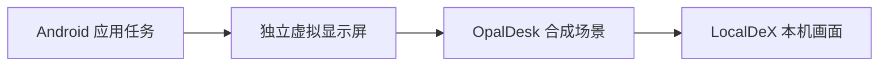

# OpalDesk Android 窗口引擎重构方案

设计草案 · 2026-11-22

## 目标

把 LocalDeX 的工作台窗口做成由 OpalDesk 统一合成的画面。应用卡片拖向中间时替换主工作区，拖向左右时并排显示两个应用。应用画面、标题栏和触摸区域使用同一份几何数据。用户可以在切换途中反向拖动，应用内容和输入焦点能从当前状态继续。

第一阶段使用现有的免 Root Shell 激活方式，在小米 HyperOS 平板上验证两个应用。任务栏、小部件、应用抽屉继续由现有桌面界面承载。macOS 串流和 Type-C 输出在原型阶段继续使用各自的现有输出链路。

## 现有实现与问题

| 环节 | 当前实现 | 对切换的影响 |
| --- | --- | --- |
| 工作台卡片落位 | `DesktopShellCoordinator` 先放置拖入的应用，等待窗口状态，再调整配对窗口、最小化旧窗口和切换焦点 | 一个操作可能出现多个中间画面 |
| 标题栏与触摸区域 | 交互期间可以先用预期窗口位置绘制，随后由守护进程快照对齐 | 系统画面尚未移动时，边框可能先到新位置 |
| HyperOS 多窗适配 | `TaskApiAdapter` 结合窗口事务、`resizeTask` 和重查。已有代码针对任务实际图层未跟上边界的情况再次调整 | 切换耗时取决于系统任务和图层各自的更新时间 |

现状入口见 [工作台排窗与状态同步](../helper/src/io/github/lengsukq/opaldesk/desktop/state/DesktopShellCoordinator.kt)、[系统窗口适配](../bridge/src/io/github/lengsukq/opaldesk/daemon/platform/TaskApiAdapter.java)。

## 架构选择

Linux 内核提供设备驱动、进程隔离和缓冲区基础能力。Android 的 WindowManager 决定 Activity 的显示位置、任务生命周期和输入焦点，SurfaceFlinger 负责图层合成。NDK 的 `ASurfaceControl` 可以操作本进程创建或已经取得句柄的图层。跨应用 Activity 嵌入也需要目标应用选择允许。跨品牌的一致动画应建立在 OpalDesk 可控的输出画面上，应用启动和输入仍受 Android 的显示策略约束。 [SurfaceFlinger 与 WindowManager](https://source.android.com/docs/core/graphics/surfaceflinger-windowmanager) · [NDK 图层 API](https://developer.android.com/ndk/reference/group/native-activity) · [跨应用 Activity 嵌入](https://developer.android.com/develop/ui/views/layout/activity-embedding#cross-app)

| 路线 | 用途与取舍 |
| --- | --- |
| 共享虚拟屏上的系统多窗 | 复用当前实现，设备兼容时可批量提交窗口事务。系统仍负责实际应用图层的排布和部分动画 |
| 独立虚拟屏与本地合成 | 作为 LocalDeX 原型。每个可见应用占用一个虚拟屏，由 OpalDesk 负责图层排列。需要验证多显示屏输入、输入法和内存成本 |
| 系统级 WM Shell 集成 | 适用于可定制系统镜像或 OEM 合作的设备。系统可以提供任务和动画句柄，交付与维护按 ROM 进行 |

## 独立虚拟屏方案

| 组件 | 职责与复用点 |
| --- | --- |
| 守护进程 | 按窗口会话维护 `displayId`、任务 ID、实际分辨率和生命周期。复用 [虚拟显示屏创建](../bridge/src/io/github/lengsukq/opaldesk/daemon/platform/VirtualDisplayFactory.java) 和 [macOS 单应用会话](../bridge/src/io/github/lengsukq/opaldesk/daemon/stream/RemoteDisplaySession.java) 的启动与回收逻辑。LocalDeX 的应用画面使用本地 Surface 通路 |
| 合成场景 | 以工作区像素坐标保存应用内容矩形、标题栏、裁剪、层级和分隔条。原型可用 `SurfaceTexture` 输入加 GPU 合成，避免将帧读回 CPU 或经视频编码再解码。以真机数据评估合成开销和实际缓冲区数量 |
| 布局与动画 | 整区、左半屏、右半屏共享一个布局状态。一次动作产生一个新布局版本，合成按同一渲染时钟更新两个应用画面和边框。新的拖动从当前画面几何接管，旧版本的异步回调只能清理自己的资源 |
| 输入与焦点 | 在当前已呈现的布局上做命中测试和逆坐标变换。按下时绑定手势到目标 `displayId`，持续转发到抬起或取消。标题栏、分隔条和小部件由桌面本地消费。键盘转发前确认焦点所在显示屏，并复用 [现有输入注入](../bridge/src/io/github/lengsukq/opaldesk/daemon/input/InputInjector.java) |

### 一次拖放如何结束

1. 拖动时仅更新合成画面的变换和落点预览，应用维持当前逻辑尺寸。取消拖动时恢复上一个已确认布局。
2. 松手时计算整区或双窗布局。已有应用直接使用当前画面，新启动应用先等待可呈现的首帧。启动失败或首帧超时就保持上一个可用布局。
3. 合成器在同一帧推进窗口位置、裁剪和标题栏，窗口尺寸确有变化时，动画落位后对各虚拟屏合并提交一次最终尺寸。新尺寸的画面到达前保留上一张有效帧，输入仍以实际显示的尺寸映射。
4. 在应用进入后台或最小化时暂停不可见画面的合成。关闭会话、Surface 丢失、屏幕旋转和 LocalDeX 退出时，取消相关手势和待提交操作。迁移或结束目标任务后释放虚拟屏，避免遗留显示屏和焦点。 [VirtualDisplay 的尺寸更新与释放行为](https://developer.android.com/reference/android/hardware/display/VirtualDisplay)

## 兼容性与降级

| 能力 | 首轮验证与降级 |
| --- | --- |
| 启动或迁移原生应用 | 运行时检查副屏能力与目标 App 的启动结果。失败时保留当前工作台，受影响应用可走现有系统窗口路径。 [ActivityOptions 的副屏启动规则](https://developer.android.com/reference/android/app/ActivityOptions#setLaunchDisplayId(int)) |
| 键盘与输入法 | 分别验证外接键盘、中文输入法候选词、两个应用往返切换。对不能稳定切换的机型保留现有窗口引擎。 [Android 多屏输入法](https://source.android.com/docs/core/display/multi_display/ime-support) |
| 固定方向与受保护窗口 | 验证竖屏 App 的裁剪、留白和触摸变换。对系统限制显示的内容提供明确提示，保留系统原有的保护策略。 [Android 窗口内容保护](https://developer.android.com/reference/android/view/WindowManager.LayoutParams#FLAG_SECURE) |
| 资源开销 | 原型最多同时保留两个可见应用的虚拟屏，记录闲置、单窗和双窗的内存与 GPU 开销。若退出后无法稳定回收资源，保持实验入口默认关闭 |

## 实施与验收

| 阶段 | 交付及通过标准 |
| --- | --- |
| 双应用原型 | 在当前小米平板上先用两个可重复测试的应用验证整区、左分屏、右分屏及双窗换位。连续做 50 次切换，允许中途反向拖动。每次落位时画面、标题栏和点击热区对齐，应用无黑帧、残影、意外重启或错焦点 |
| 输入与生命周期 | 加测支持文本编辑和多指触控的应用。验证中文输入、物理键盘、滚轮、旋转、息屏唤醒、应用退出及连续重入。手势取消后无残留指针，退出后虚拟屏数量回到本轮测试前的基线 |
| 设备验证 | 覆盖当前 HyperOS 平板、接近 AOSP 的设备与另一主流定制系统。记录 Android API、ROM 版本、实际支持的能力与降级结果，再决定默认启用范围 |
| 逐步迁移 | 双窗验收后再迁移启动、最小化、恢复、自由缩放及更多分屏布局。接入其他屏幕出口前，单独验证原有 macOS 串流和 Type-C 输出 |

同机型、同分辨率、同刷新率采集旧引擎和原型数据。记录切换首帧延迟、落位到新尺寸首帧耗时、平均与 P95 帧间隔、内存和退出后的显示屏数量。优先用 Perfetto 查看支持的 FrameTimeline 轨道，SurfaceView 或自有合成层缺少轨道时用合成时间戳和屏幕录制核对。性能结论以真机对照数据为准。 [Perfetto FrameTimeline](https://perfetto.dev/docs/data-sources/frametimeline)
