# ExtBridge 使用说明书 (`v3.4.1`)

> **无需 Root · 单个 APK 自激活 · 支持「DeX 独立扩展桌面」与「增强原生镜像信息副屏」双工作模式**

本文档详细介绍 **ExtBridge v3.4.1** 的安装激活、两大外接显示模式（**DeX 独立桌面模式** & **增强原生镜像模式**）、自由分屏、一键黑屏省电、外接鼠标跨屏与平板触控控制等完整功能与实机界面说明。

---

## 目录

1. [环境准备与权限授予](#1-环境准备与权限授予)
2. [激活后台守护进程（三种方式）](#2-激活后台守护进程三种方式)
3. [主控制台概览 (`MainActivity`)](#3-主控制台概览)
4. [模式一：DeX 独立扩展桌面与 Dock 栏](#4-模式一dex-独立扩展桌面与-dock-栏)
   - [4.1 独立桌面与分应用兼容策略](#41-独立桌面与分应用兼容策略)
   - [4.2 Dock 栏、Win11 风格快捷控制面板与一键黑屏](#42-dock-栏win11-风格快捷控制面板与一键黑屏)
   - [4.3 DeX 自由分屏模式（横屏左右 / 竖屏上下）](#43-dex-自由分屏模式横屏左右--竖屏上下)
5. [模式二：增强原生镜像模式（信息侧边栏 & 小组件）](#5-模式二增强原生镜像模式信息侧边栏--小组件)
   - [5.1 统一单侧边栏（左对齐 / 右对齐）与主题切换](#51-统一单侧边栏左对齐--右对齐与主题切换)
   - [5.2 双翼侧边栏（左右对称布局）](#52-双翼侧边栏左右对称布局)
   - [5.3 外置鼠标跨屏控制与主屏副屏直控 (`SideControlActivity`)](#53-外置鼠标跨屏控制与主屏副屏直控)
   - [5.4 镜像侧边栏最低亮度省电卡片](#54-镜像侧边栏最低亮度省电卡片)
6. [虚拟触摸板与键盘输入转发 (`TouchpadActivity`)](#6-虚拟触摸板与键盘输入转发)
7. [常用 ADB / 快捷广播控制指令](#7-常用-adb--快捷广播控制指令)
8. [常见问题与故障排查](#8-常见问题与故障排查)

---

## 1. 环境准备与权限授予

- **适用设备**：支持 USB-C DP Alt Mode 视频输出的 Android 设备（建议 **Android 11 / API 30 以上**，实测覆盖 Xiaomi HyperOS 平板及手机如 **REDMI K Pad**、**REDMI K90 Pro** 等）。
- **必需基础权限**（首次启动控制台将自动依次引导）：
  1. **通知权限 (`POST_NOTIFICATIONS`)**：用于前台常驻保活及通知栏快速切模式、配对输码。
  2. **悬浮窗权限 (`SYSTEM_ALERT_WINDOW`)**：用于在外接屏渲染 Dock、快捷面板、鼠标准星、分屏分割条及镜像侧边栏。
  3. **无障碍服务 (`ExtBridge 平板辅助手势`)**：用于高级叠加层穿透、主屏一键黑屏最低亮度保护遮罩与全局辅助手势。
     - 若 Android 13+ 系统提示「受限设置」开关灰显，可点击 App 内引导按钮进入 **应用详情 → 右上角 `⋮` → 允许受限设置**，或在通过电脑 ADB / Root 激活时由守护进程自动解锁。
  4. **模拟输入（部分定制 ROM）**：若使用触控板或鼠标准星时看到指针动画但点不动图标，请前往系统 **开发者选项** 中开启 **「USB 调试（安全设置）/ 允许模拟点击」**。

---

## 2. 激活后台守护进程（三种方式）

Android 设备每次重启后，Shell 守护进程 (`ExtBridge`) 都会退出，需重新激活一次（任选其一）：

### 方式 A：免 Root · 本机无线调试自激活（无需电脑）
APK 已内置 `arm64-v8a` 原生 `adb` 二进制，无需连接电脑：
1. 开启手机/平板的 **设置 → 开发者选项 → 无线调试**。
2. 在 ExtBridge 激活弹窗点击 **「发送快捷配对通知」**，再进入无线调试页的 **「使用配对码配对设备」**。
3. 直接在顶部下拉通知栏填入 6 位配对码即可完成配对并自动连接拉起守护进程；若曾配对过同一设备，点 **「已配对·直接连接」** 即可。
> 说明：`AdbBootstrap` 会自动过滤 `tun*` / `utun*` 等 VPN 虚拟网卡，优先匹配局域网真实 IP。

### 方式 B：免 Root · 电脑 ADB 一键拉起
通过数据线或局域网连上电脑 ADB 后执行以下命令（多设备请补充 `adb -s <序列号>`）：
```bash
adb shell "(pm path com.extbridge.helper | head -n1 | cut -d: -f2; echo assets/extbridge.jar) | xargs unzip -p > /data/local/tmp/extbridge.jar && chmod 644 /data/local/tmp/extbridge.jar && appops set com.extbridge.helper SYSTEM_ALERT_WINDOW allow && appops set com.extbridge.helper RUN_ANY_IN_BACKGROUND allow && appops set com.extbridge.helper 10021 allow 2>/dev/null; appops set com.extbridge.helper ACCESS_RESTRICTED_SETTINGS allow 2>/dev/null; pm grant com.extbridge.helper android.permission.POST_NOTIFICATIONS 2>/dev/null; dumpsys deviceidle whitelist +com.extbridge.helper >/dev/null 2>&1; pkill -f '^app_process.*ExtBridge' 2>/dev/null; sleep 0.2; CLASSPATH=/data/local/tmp/extbridge.jar nohup app_process /data/local/tmp com.extbridge.daemon.ExtBridge >/data/local/tmp/extbridge.log 2>&1 </dev/null &"
```

### 方式 C：已 Root 设备（Magisk / KernelSU / APatch）
在激活弹窗选择 **「👑 Root 激活 (免 ADB 权限)」** → 点击 **「👑 一键 Root 注册并激活服务」**。守护进程拉起后会自动降权为 `uid=2000 (shell)` 身份运行，并可开启“启动软件时自动 Root 激活”。

---

## 3. 主控制台概览

打开 ExtBridge 后，主屏幕显示控制台首页，顶部展示当前守护进程连接状态、物理外接显示器信息及虚拟显示画布状态：

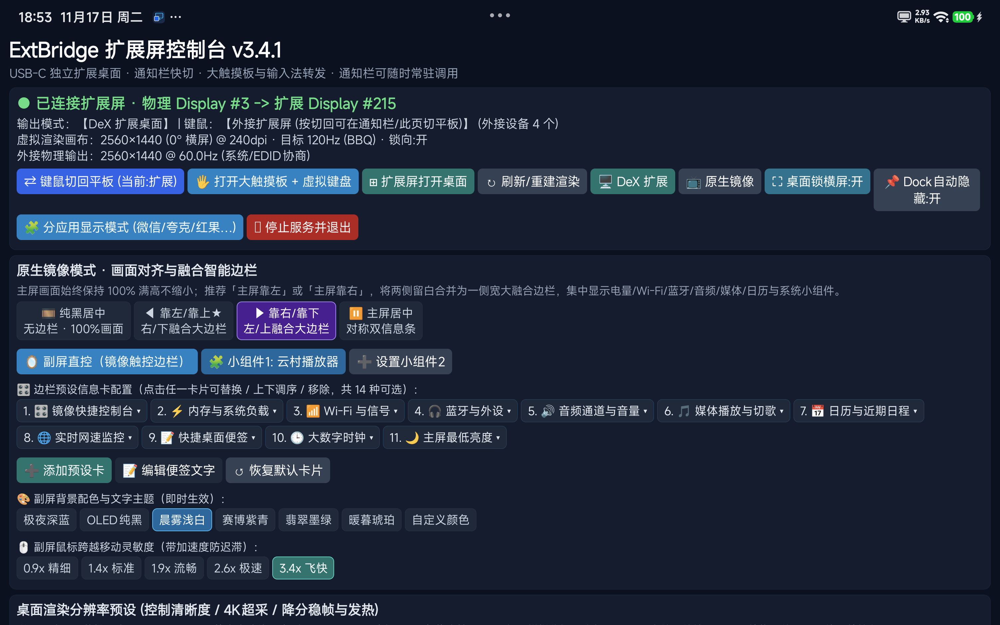

切换至下方或镜像配置面板可调整外接渲染分辨率、DPI 缩放、四向旋转（`0° / 90° / 180° / 270°`）与镜像黑边扩展副屏选项：

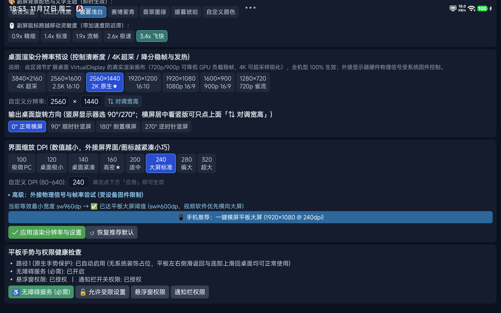

- **桌面渲染分辨率（虚拟画布）**：支持 `1280×720`（低负载省电）至 `3840×2160`（4K 超采样锐化）及自定义宽高，所有支持 DP Alt Mode 的设备均 100% 生效。
- **高级物理模式尝试**：默认折叠收纳物理 EDID 模式与目标帧率选项；当硬件固件锁死外接物理信号（如部分 HyperOS 设备固定 `2560×1440@60Hz`）时，系统会如实提示，由虚拟画布完成等比/居中缩放铺满。
- **停止并退出**：控制台顶部及通知栏均提供 **「⏻ 停止服务并退出」**，点击后会安全恢复主屏亮度、释放 `VirtualDisplay` 并彻底退出守护进程与前台服务。

---

## 4. 模式一：DeX 独立扩展桌面与 Dock 栏

### 4.1 独立桌面与分应用兼容策略

插上 Type-C 显示器后，外接屏自动呈现独立的 `LauncherActivity` 桌面：

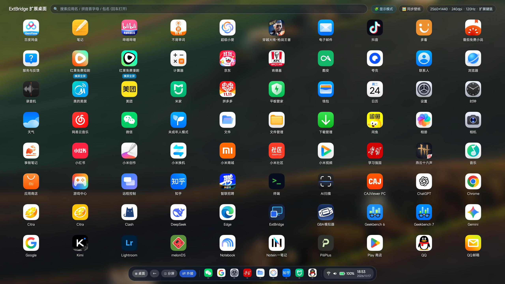

- **壁纸同步与高效率启动**：自动适配主屏壁纸毛玻璃背景，支持应用名称与拼音首字母快速检索。
- **分应用显示兼容模式（长按 / 鼠标右键图标即可修改）**：
  - **跟随系统默认**（默认）：零干预启动，微信、夸克、拼多多等正常按平板/大屏尺寸布局。
  - **强制横屏全屏**：通过 `am compat` 精准解锁仅锁定竖屏的短剧、视频类应用（如截图中的 `红果免费短剧`、`红果免费漫剧` 等预设徽标应用），实现 `2560×1440` 满屏横屏观看。
  - **竖屏居中兼容 / 自由小窗模式**：面向固定比例工具 App 或需要窗口并排的办公应用。
  - 所有应用策略持久化于 `/data/local/tmp/extbridge_apps.conf`，不会修改全局系统开关，随时可在控制台一键重置。

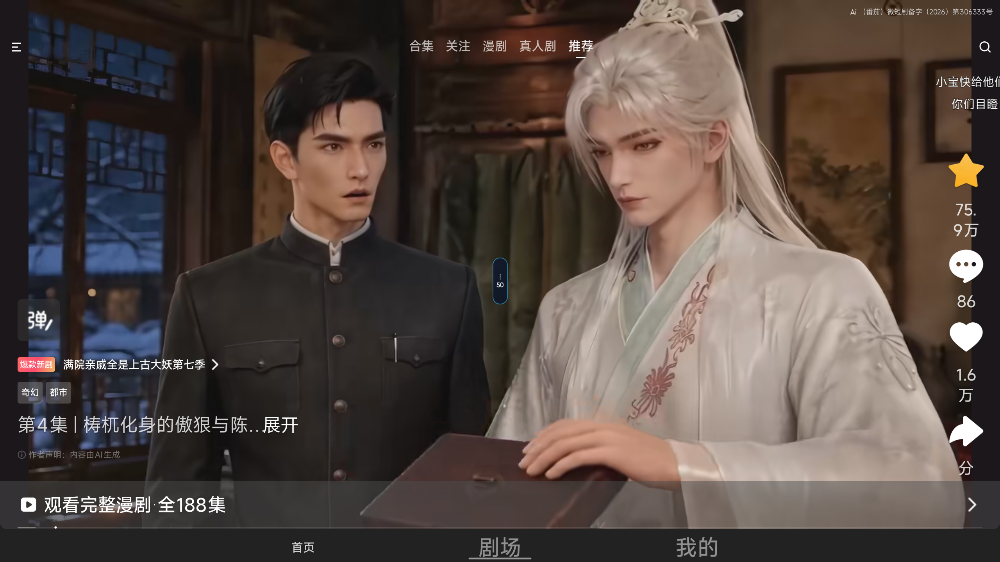

### 4.2 Dock 栏、Win11 风格快捷控制面板与一键黑屏

外接屏底部提供自适应 DPI 缩放的桌面 Dock 任务栏：
- **核心入口**：桌面键 (`⊞`)、返回键 (`←`)、分屏键 (`◫`)、运行任务快切列表、输入控制开关与时间显示；支持**应用内闲置约 `2.6s` 自动隐藏为底边触发条**（鼠标移至底边或轻点即刻唤醒），也可锁定常驻。
- **快捷控制浮窗（Flyout）**：点击 Dock 右下角状态区展开 Win11 风格毛玻璃快捷面板，内含系统音量条、蓝牙 / Wi-Fi / 设置快捷入口、DeX 与原生镜像切换，以及 **「🌙 一键黑屏 (平板最低亮度)」** 按钮：

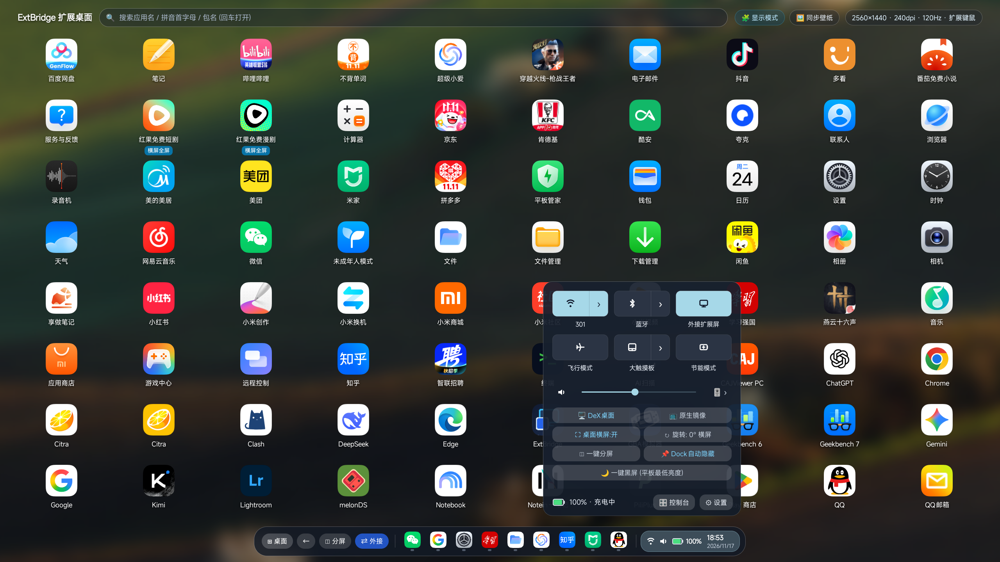

- **一键黑屏（主屏最低亮度 + 熄屏护眼遮罩）**：
  - 在外接屏办公、观影时，点击 Flyout 中的 **「🌙 一键黑屏 (平板最低亮度)」**，系统会在主机/平板端盖上一层纯黑防误触遮罩（支持 `NavAssistService` 无障碍层级叠加兜底），并自动将平板主屏亮度降至系统最小值 `1`，同时在内存/配置中记录原始亮度。
  - **双击主屏幕任意位置**即可安全退出黑屏并精确还原进入前的屏幕亮度；即使服务异常退出或断开外接屏，系统关闭流程也会自动还原亮度防止“屏幕永久黑屏”。

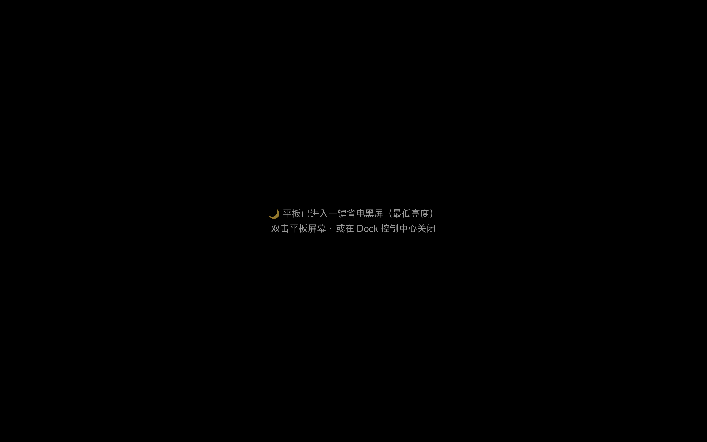

### 4.3 DeX 自由分屏模式（横屏左右 / 竖屏上下）

当外接屏连接后，支持将任意两个应用并排运行：

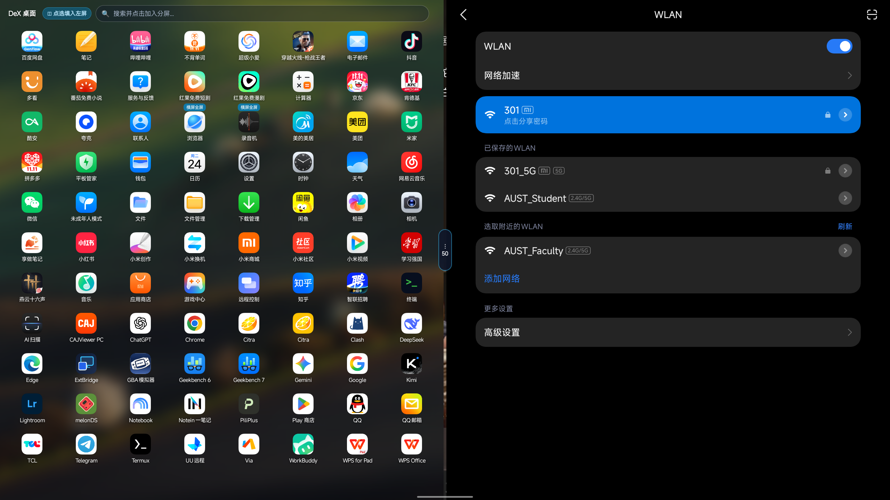

- **多种进入方式**：
  1. 点击 Dock **`◫ 分屏`** 按钮：一键将最近任务自动配对分屏，或弹出比例控制浮窗。
  2. 在扩展桌面 **长按 / 鼠标右键任意应用图标** → 选择 **`◫ 分屏：放到左屏 / 右屏`**（外接屏竖屏时自动显示为 **`放到上屏 / 下屏`**），放置一侧后轻点桌面第二个应用即可自动补齐另一侧。
- **可拖拽分割条与方向自适应**：
  - 画面中线提供带比例角标（如 `:50`）的可拖拽手柄，按住左右或上下拖动即可按 `25% ~ 75%` 区间实时调整双窗口尺寸；轻点手柄可唤出快捷预设（`3:7 / 4:6 / 5:5 / 6:4 / 7:3`、`⇄/⇅ 互换位置`、`✕ 退出分屏`）。
  - 旋转屏幕为 `90° / 270°` 竖屏时自动重排为上下分屏。

---

## 5. 模式二：增强原生镜像模式（信息侧边栏 & 小组件）

许多平板/手机屏幕比例（如 `16:10` / `3:2`）与常见 `16:9` 显示器进行**原生同屏镜像**时，外接屏左右两侧天然留有黑色空白边距。ExtBridge 将这些黑边改造成高信息密度的**实时状态副屏与桌面小组件停靠区**！

### 5.1 统一单侧边栏（左对齐 / 右对齐）与主题切换

可将原本居中的镜像画面推向右侧或左侧，将黑边空间合并为**单一宽侧边栏**，展示更多信息和系统桌面小组件（AppWidget）：

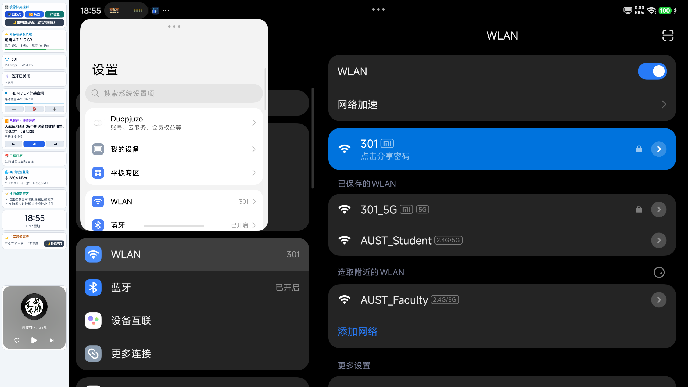

- **14 款可自定义替换的内置预设组件**：
  - `🕒 大数字时钟`（高对比超大字号时间与星期日期） / `🔋 电池温压详情`（电量、功耗、温度与电压）
  - `📶 Wi-Fi 与信号`（SSID、实时速率与 `dBm` 强度） / `🎧 蓝牙与外设`（蓝牙状态与已连接耳机/键鼠）
  - `🔊 音频通道与音量`（实时显示 `HDMI / DP 外接音频` 等路由通道，支持直接点按 `➖ / 🔇 / ➕`）
  - `🎵 媒体播放与切歌`（当前曲目与 App，支持点按 `⏮ / ⏯ / ⏭` 切歌控制）
  - `📅 日历与近期日程` / `⚡ 内存与系统负载` / `🌐 实时网速监控` / `💾 存储与亮度信息`
  - `⏱ 专注番茄钟`（25 分钟倒计时，边栏直接启停/重置） / `📝 快捷桌面便签`（自定义待办/备忘）
  - `🎛 镜像快捷控制台`（切回 DeX / 切换对齐方位 / 切换键鼠 / 极暗） / `🌙 主屏最低亮度`（省电护眼开关）
- **系统桌面小组件 (`AppWidget`) 防拉伸比例约束**：支持绑定任意系统/第三方小组件到左/右槽位，并提供 **`自动原比例`**、**`方形 1:1`**、**`竖屏 3:4`**、**`宽屏 16:9`**、**`铺满槽位`** 五档比例锁定，防止非等宽侧边栏导致组件变形拉伸。
- **6 款视觉主题 + 自定义背景颜色**：支持 **`极夜深蓝`**、**`OLED纯黑`**、**`晨雾浅白`**（如图所示）、**`赛博紫青`**、**`翡翠墨绿`**、**`暖暮琥珀`** 与 **`自定义颜色`**。

### 5.2 双翼侧边栏（左右对称布局）

当偏好镜像画面居中或外接屏超宽比留边对称时，可切换为 **双翼侧边栏** 模式，左右两侧黑边同步排布信息卡片、时钟与小组件：

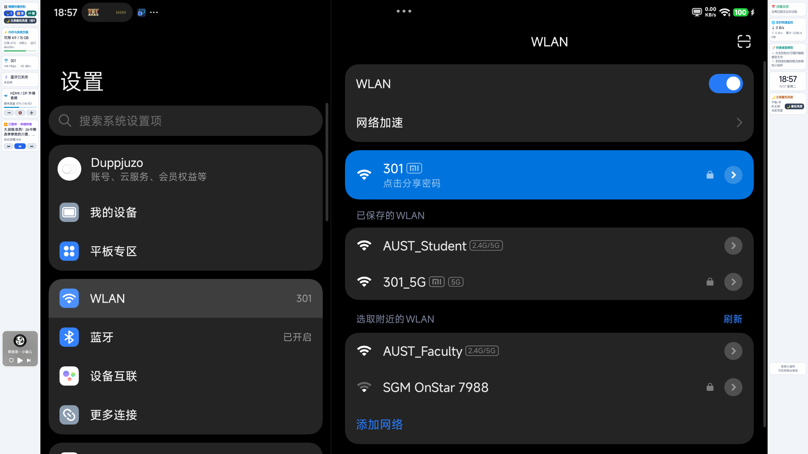

### 5.3 外置鼠标跨屏控制与主屏副屏直控

在增强原生镜像模式下，ExtBridge 打通了物理边界与触控控制：
- **外置实体鼠标外屏显示与跨屏自由移动**：外接鼠标在镜像模式下可正常显示于外接屏；将指针滑过镜像区左/右边缘即可自动进入黑边信息栏点击、滚动与右键操作（滑回镜像边界即自动释放）；同时支持 **`0.9x 精细`** / **`1.4x 标准`** / **`1.9x 流畅`** / **`2.6x 极速`** / **`3.4x 飞快`** 五档光标移速与不同 DPI 屏幕比例自动适配，并修复了触碰边缘误触发弹出 ExtBridge 主界面的问题。
- **无键鼠时用手指直接点按 (`SideControlActivity`)**：如果没有连接实体键鼠，可以在主控制台点击 **「副屏直控」**（或在虚拟触摸板右下角点击 **`副屏直控`**），将外接屏黑边侧边栏同步投射到平板主屏进行高灵敏度手指点击与滑动操作（也可直接通过虚拟触控板点按操作副屏小组件）：

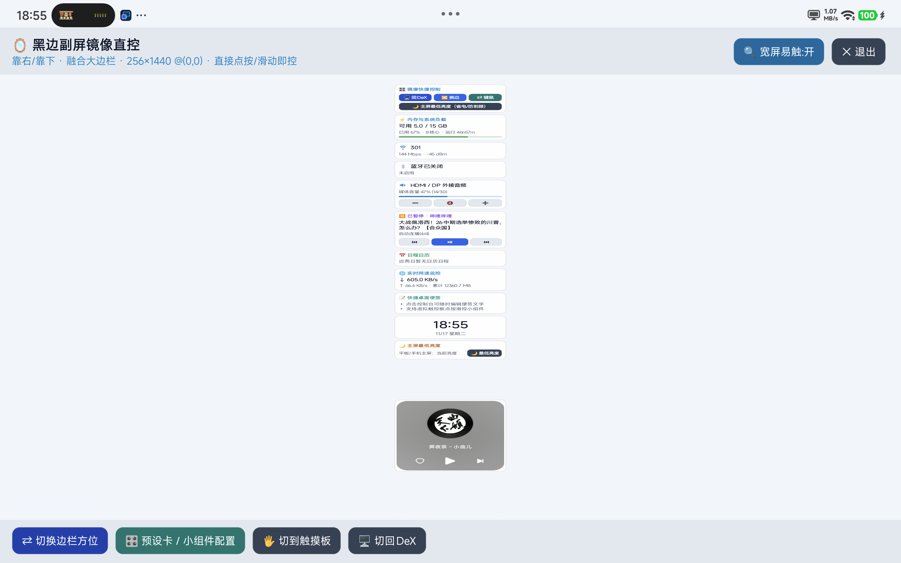

### 5.4 镜像侧边栏最低亮度省电卡片

统一侧边栏顶部卡片栏与双翼侧边栏内部均集成了 **`主屏最低亮度 (省电)`** 快捷开关卡片。轻点即可在不遮挡信息展示的情况下把主屏背光降至最低 `1`，再次点击立即恢复进入前的亮度。

---

## 6. 虚拟触摸板与键盘输入转发

不接外置键鼠时，打开控制台的 **「触控板」**（或通知栏快捷按钮）即可将平板/手机屏幕变为全功能大面积触摸板：

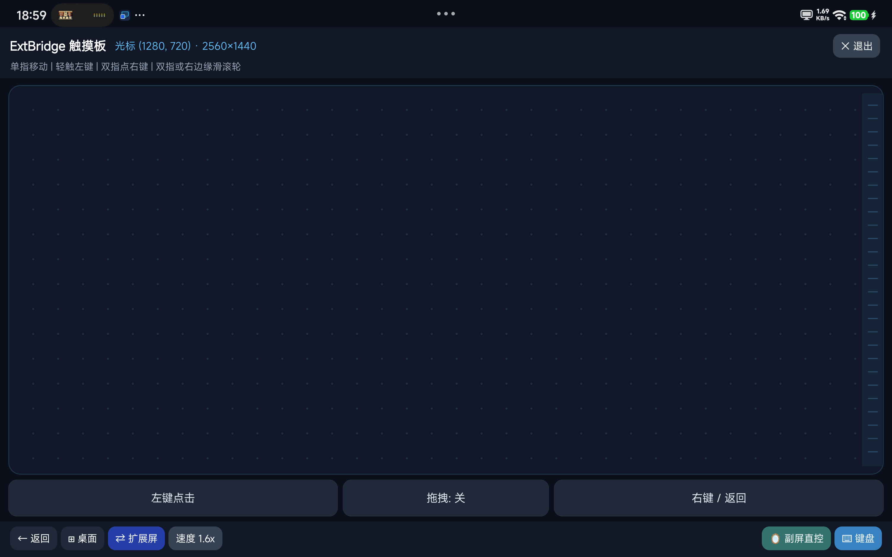

- **触控手势**：
  - **单指滑动**：移动外接屏鼠标光标（底部支持调节光标倍速，如图中 **`速度 1.6x`**）
  - **单指轻触 / 左下方 `左键点击`**：触发左键点击
  - **双指轻触 / 右下方 `右键 / 返回`**：触发右键菜单或系统返回
  - **双指滑动 / 最右侧竖向刻度区**：网页与列表滚轮滚动
  - **中间 `拖拽: 关/开` 开关**：一键切换长按拖拽状态，便于圈选或拖动分屏手柄与小窗
- **底部快捷栏**：
  - `← 返回` / `⊞ 桌面`：直接控制外接屏返回或回桌面
  - `⇄ 扩展屏 / 主屏`：快速切换操控焦点
  - `副屏直控`：镜像模式下直接跳转操控黑边小组件区域
  - `⌨ 键盘`：弹出主机端软键盘，并将输入文字、回车与退格直接转发给外接屏当前焦点应用

---

## 7. 常用 ADB / 快捷广播控制指令

`ControlReceiver` 已在 `AndroidManifest.xml` 中注册支持以下显式及包名限定广播（可用于 Tasker / MacroDroid / 快捷方式自动化）：

| Action 名称 | 作用说明 |
| :--- | :--- |
| `com.extbridge.helper.TOGGLE_INPUT` | 切换外接输入映射状态 |
| `com.extbridge.helper.STATE_SYNC` | 同步守护进程与辅助服务状态 |
| `com.extbridge.helper.REBUILD` | 重建外接显示或应用最新分辨率设置 |
| `com.extbridge.helper.LAUNCH_EXT_HOME` | 在外接屏启动/拉回 DeX 桌面主页 |
| `com.extbridge.helper.TOGGLE_MIRROR` | 在 DeX 独立桌面与原生镜像模式间切换 |
| `com.extbridge.helper.MIR_EDGE_CAPTURE` | 触发或切换镜像侧边栏鼠标边缘捕获 |
| `com.extbridge.helper.SET_MIRROR_SIDE_MODE` | 设置镜像侧边栏布局模式 |
| `com.extbridge.helper.SPLIT_ACTION` | 触发或调整 DeX 分屏动作 |
| `com.extbridge.helper.SET_ROTATION` | 设置外接渲染旋转角度（`--ei rotation 0/90/180/270`） |
| `com.extbridge.helper.SET_DOCK_AUTO_HIDE` | 开关 Dock 自动隐藏（`--ez auto_hide true/false`） |
| `com.extbridge.helper.EXIT_ALL` | 安全恢复亮度并停止全部服务与守护进程 |

示例（指定包名发送）：
```bash
adb shell am broadcast -a com.extbridge.helper.TOGGLE_MIRROR -p com.extbridge.helper
```

---

## 8. 常见问题与故障排查

1. **点击扩展桌面图标只高亮不弹出界面？**
   - 小米 / HyperOS 设备需要后台弹出界面权限 `MIUIOP 10021`。请在重新激活守护进程后重启一次桌面，或检查电脑 ADB 命令中是否已执行 `appops set com.extbridge.helper 10021 allow`。
2. **外接屏看得出鼠标移动，但点不到任何东西？**
   - 请检查手机/平板 **开发者选项 → USB 调试（安全设置）/ 允许模拟点击** 是否开启；若主控制台顶部出现红色 `INJECT_EVENTS` 提示条，按引导开启后点重试即可。
3. **修改了渲染分辨率，显示器 OSD 菜单仍显示 `1080p@60` 或 `2K@60`？**
   - 显示器 OSD 显示的是硬件 EDID 物理链路信号，部分定制固件锁定了外部物理模式；ExtBridge 控制台调整的是 `VirtualDisplay` 实际渲染缓冲分辨率（降分辨率省电稳帧 / 超采样锐化 / 宽高比适配），两者由系统合成器硬件缩放衔接，互不冲突。
4. **如何完全恢复手机/平板原始环境与清除兼容覆写？**
   - 在控制台或通知栏点击 **「⏻ 停止服务并退出」**（会自动还原黑屏亮度并关闭 `VirtualDisplay`）。
   - 如需清除 `am compat` 单应用兼容覆写，可在控制台 **分应用显示模式** 页点击 **「↺ 全部重置为默认」**，或通过 ADB 执行 `adb shell am compat reset-all <包名>`。
